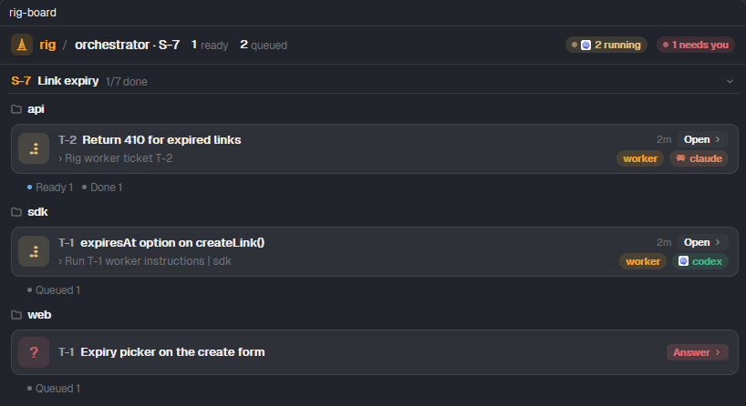

<div align="center">

# ▲ rig

**One manager per repo. One orchestrator across them. Every coding agent on one board.**

Talk to a single session. As a **manager** it writes tickets for one repo, hands them to worker and reviewer agents (Claude Code, Codex, opencode, pi, omp, Command Code), keeps them on track, and merges what passes review. As an **orchestrator** it takes a change that spans several repos, starts a manager in each, and answers them for you. Everything runs in [herdr](https://herdr.dev) panes you can watch and type into, or headless in the background.

[](https://github.com/zanuartri/herdr-rig/actions/workflows/test.yml)
[](LICENSE)


<sub>A Claude Code manager (left) split one request into five tickets. Four run in parallel on opencode and pi, and a CHANGELOG ticket waits for two of them.</sub>

</div>

## Why

Running several coding agents at once is easy. Keeping track of them is not. Which one is stuck on a question? Did the review pass? Whose branch is safe to merge? rig gives that job to one agent:

- **You talk to one session.** The manager turns a request into tickets with a goal, acceptance checks and verify commands, then dispatches them.
- **Cross-repo changes, one conversation.** An API, its web client and the SDK change together: the orchestrator writes one brief per repo with the shared contract word for word, starts a manager in each, and brings you only the decisions that are yours.
- **Any harness, any role.** Manager, worker and reviewer can each be Claude Code, Codex, opencode, pi, omp or Command Code, with their own model and effort. Mix them freely, for example a cheap fast worker with a reviewer from a different model family.
- **Isolated by default.** Each ticket gets its own git worktree and `rig/T-n` branch, cut from the branch you are on.
- **Review that isn't redundant.** The manager only triages the diffstat. One reader, a reviewer or the manager, reads the actual diff.
- **Nothing to babysit.** Workers report back on their own. A watcher tells the manager when an agent goes idle without reporting, gets blocked, or exits.
- **Minimal by design.** One Bun file and SQLite. The judgement lives in four skills (`orchestrator`, `manager`, `worker`, `reviewer`), not in code. No daemon, no MCP server.

## The board

The board groups tickets by what they need from you: **Needs you · Working · Ready · Queued · To do · Done**. It shows who is on each ticket (role, harness, model, effort), what the agent says it is doing, and what a queued ticket waits on.

| herdr desktop app (native mod) | terminal (herdr CLI, or any terminal) |
|---|---|
|  |  |
| Click **Open** to jump to an agent's pane. A toast appears when something needs you. | Spinners, harness colors, and a live activity feed in whatever height is left. |

## Install

You need [Bun](https://bun.sh) ≥ 1.2, git, and either the [herdr](https://herdr.dev) CLI (≥ 0.9) or the herdr desktop app. `gh` is only needed for `merge pr`.

```sh
bun add -g github:zanuartri/herdr-rig   # puts `rig` on your PATH
rig install       # copies the rig-orchestrator/-manager/-worker/-reviewer skills into every agent it finds,
                  # and the board mod into the herdr desktop app if it is installed
```

To update, run `rig update`. rig checks for a new release at most once a day and says so in one line (`RIG_NO_UPDATE_CHECK=1` turns that off). The installed skills only point at `rig skill <role>`, so they always match the rig you have and never need reinstalling.

To hack on it instead, clone the repo and run `bun link` inside it. `rig` then runs your checkout, so changes apply right away, and `rig update` does a `git pull`.

For Claude Code you can use the plugin instead: `claude plugin marketplace add zanuartri/herdr-rig`, then `claude plugin install rig@herdr-rig`.

## Quick start

Every session picks one role. Work in **one repo**: start a manager. A change across **several repos**: start an orchestrator (see [Orchestrating several repos](#orchestrating-several-repos)).

Open your agent in a herdr pane inside a git repo and start the manager skill:

| harness | start the manager |
|---|---|
| Claude Code | `/rig-manager` (plugin: `/rig:manager`) |
| Codex | `$rig-manager` |
| opencode | "use the rig-manager skill" |
| pi, omp | `/skill:rig-manager` |
| Command Code | `/rig-manager` |
| anything else with a shell | "run `rig skill manager` and follow it" |

Then ask for work in plain words:

> Add link expiry and a stats endpoint, review both, and write a README with pi.

The first time in a repo, the manager asks once about harness, model, effort, pane/tab/headless, worktrees, autonomy and how to merge, and remembers the answers (`rig get`). After that it only asks when something is actually unclear.

## How it works

```
 you ──► manager ──rig new──► ticket T-3 (goal · acceptance · verify · scope)
            │
            ├─rig dispatch──► worker  (own worktree, rig/T-3) ──rig say──► manager
            ├─rig dispatch --role reviewer──► reviewer ── PASS / FIX ──► manager
            └─merge (squash or PR) ──rig edit T-3 status=done──► panes closed, worktree removed
```

- **State:** `<repo>/.rig/rig.db` (gitignored by itself). Tickets are numbered per repo, and several managers can share a repo. Each one owns its own tickets (`rig ls --mine`).
- **Messages:** workers and reviewers run `rig say manager "…"`. The manager listens with `rig inbox --wait` as a background command, so nothing is typed into its pane while you write. Without a listener, rig types a message in only while you are not focused on that pane, and bundles anything that piled up into one message.
- **Base branch:** a ticket starts from, and lands on, the branch the manager had checked out when it was created (`--base` picks another).
- **Order:** `rig new "…" --after T-3,T-4` keeps a ticket Queued, and the manager hears when it is unblocked.
- **Worktree spaces:** `rig set worktree herdr` (or `--worktree herdr`) opens each ticket as its own herdr space: worker on the left, reviewer on the right while it runs, and your manager space keeps just the manager and the board. `done` closes the space.
- **Cleanup:** `done` closes the ticket's panes and tabs and removes its worktree and branch once the changes are in the base branch (normal or squash merge). Unmerged work is kept. `rig clean` sweeps leftovers.

## Layout

The manager keeps the left half. The board opens by itself in the top half on the right, and up to `pane.max` (default 2) pane runs stack under it. Later runs fill overflow tabs of `tab.max` (default 8) panes each, two columns of 4: the left column fills first (four even rows), then one pane opens beside each row; a full tab opens the next. With `--mode tab` every run gets its own tab. Starting a run never moves your view: focus and the selected tab/space stay where they were. Panes always open beside the manager, in its own space, not wherever you happen to be looking.

Change it for one run with `--mode tab|pane|headless`, or for good with `rig set pane.max 3`, `rig set mode tab`, `rig set board tui|off`.

rig picks the backend from the manager's terminal: `HERDR_PANE_ID` uses the herdr CLI, and `HC_TERMINAL_ID` uses the desktop app (`hc` + `herdr-app`).

## Commands

```
rig new "title" [--body -] [--review] [--after T-1,T-2] [--base br]
rig dispatch T-3 [note] [--role worker|reviewer] [--harness h] [--model m] [--effort e] [--mode pane|tab|headless]
rig tell T-3 "…" [--now]       steer a run (--now interrupts first; headless resumes the session)
rig stop T-3 · rig close T-3|<run#> · rig ps · rig ls [--mine] · rig show T-3 · rig inbox [--wait]
rig edit T-3 status=done       close panes, remove the worktree once merged
rig board [--open|--tab] [--tui] [--mine]
rig get · rig set worker.harness codex · rig set harness.<name> '<json>'   (add or override a harness)
rig clean [T-3] [--force] · rig install [harness…] · rig skill manager|worker|reviewer|orchestrator
rig launch <repo> --brief f · rig inbox --orch [--story S] [--wait] · rig tell <repo>:manager "…" · rig board --orch [--story S]
```

`rig help` has the full list.

## Orchestrating several repos



<sub>One story, three repos: a Claude Code worker on api, a Codex worker on sdk, and a web ticket waiting for an answer.</sub>

Start your agent in any folder (the parent of your repos works well) on the orchestrator skill (`/rig-orchestrator`, `$rig-orchestrator`, or "run `rig skill orchestrator` and follow it"), then say what you want:

> Add link expiry: api rejects expired links, web gets a date picker, the sdk gets an option. Repos are ~/src/api, ~/src/web, ~/src/sdk.

1. **It plans.** It asks for the repo paths if you didn't give them and checks each one is a git repo. It writes one brief per repo with the shared contract, the merge order and a **story** (`S-7 Link expiry`), and asks setup as one question: one proposal for every repo, or a one-line change such as `worker codex gpt-5, web: reviewer claude opus`. Repos that already have a setup keep it.
2. **It starts one manager per repo**, each in its own tab, on the manager skill and its brief. Managers work exactly as in a single repo: tickets, workers, reviews, merges.
3. **It listens.** Managers ask it first (`rig say orchestrator --story S-7 "…"`), and it hears when any ticket needs a decision or is ready. It answers what the plan already settles and brings you the rest.
4. **You watch one board**, a section per story and a heading per repo, with the same cards as a repo's own board.

A few rules keep it simple:

- **A story ties a change together.** Every ticket carries it (`rig new "…" --story S-7`), and `--story` on the board and the inbox shows only that change. One session can hold several (`--story S-7,S-8`).
- **One manager per repo.** If a repo's manager is already running, for another story or another orchestrator, `rig launch` hands it the new brief instead of starting a second one. Its tickets keep their stories apart, and merges stay in one hand.
- **Two orchestrators can share a repo.** Messages carry their story, so each orchestrator gets its own.
- **Any git repo works**, rig history or not. A repo that is never orchestrated behaves exactly as before.

```
rig launch ~/src/api --brief api.md            # api's manager in a tab, on the manager skill + this brief
rig inbox --orch --story S-7 --wait            # returns on a manager's question or a ticket that needs you or is ready
rig tell api:manager "ship the endpoint first" # typed into that manager's pane, focus-aware like any rig message
rig board --orch --story S-7 --open            # the board above, beside you
rig story S-7 "Link expiry" · rig repos [rm <repo>]
```

The orchestrator's state is one file, `~/.rig/hub.db` (`$RIG_HOME/.rig/hub.db`): the repos it knows, story names, and its inbox.

## Tested

| | herdr desktop app | herdr CLI |
|---|---|---|
| worker: Claude Code, Codex, opencode, pi, omp, Command Code | ✅ | ✅ |
| manager: Claude Code, Codex, opencode, pi, omp, Command Code | ✅ | ✅ pi, omp |
| watcher (idle / blocked / exited), board, cleanup | ✅ | ✅ |
| orchestrator: launch, inbox, tell, orchestrator board | ✅ | not yet |

`bun test` runs on Linux, macOS and Windows in CI. The pane workflow has been driven by hand on Windows, so reports from macOS and Linux are very welcome.

## Known limitations

- **Startup dialogs.** Claude Code, Codex and Command Code ask once to trust each new folder, and every worktree is a new folder. rig keeps the pane open and tells you, and the agent continues once you answer.
- **Codex as manager** runs commands in a sandbox that can't reach `.git` or herdr. Approve `rig` (and the merge `git` commands) when Codex asks.
- **opencode's background server** can hold a finished worktree folder open on Windows. `rig clean` removes it once it is released.
- **Watcher.** An agent that pauses for a long time between tool calls can be reported as idle a little early. The manager reads its screen before acting.
- **Not yet exercised end to end:** `merge pr` (push and `gh pr create`), auto-merge with `autonomy merge`, and the orchestrator on the herdr CLI.
- **Updating from a git checkout** (`git pull` instead of `rig update`) leaves the app's board mod behind. Run `rig install herdr-app` after pulling.

## Contributing

Issues and PRs are welcome. Keep it small: logic that is judgement belongs in `skills/`, and `rig.ts` only keeps state and launches runs. Run `bun test` before sending a change.

## Contributors

Thanks to everyone who has helped build rig.

[](https://github.com/zanuartri/herdr-rig/graphs/contributors)

<sub>Updated automatically. Bot and AI agent accounts are left out.</sub>

## License

[MIT](LICENSE) © Zanuar Tri Romadon
